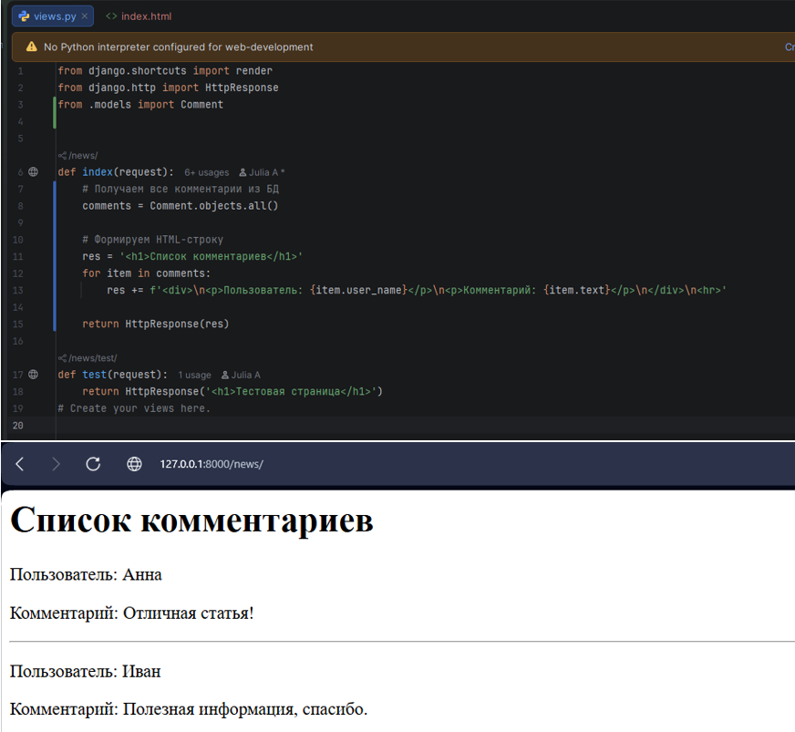
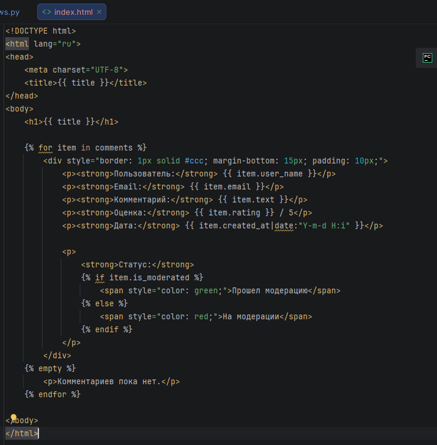
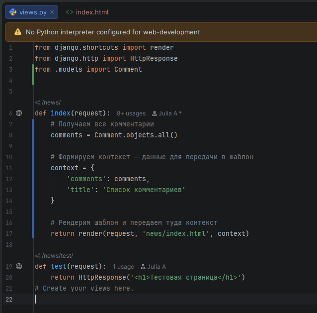
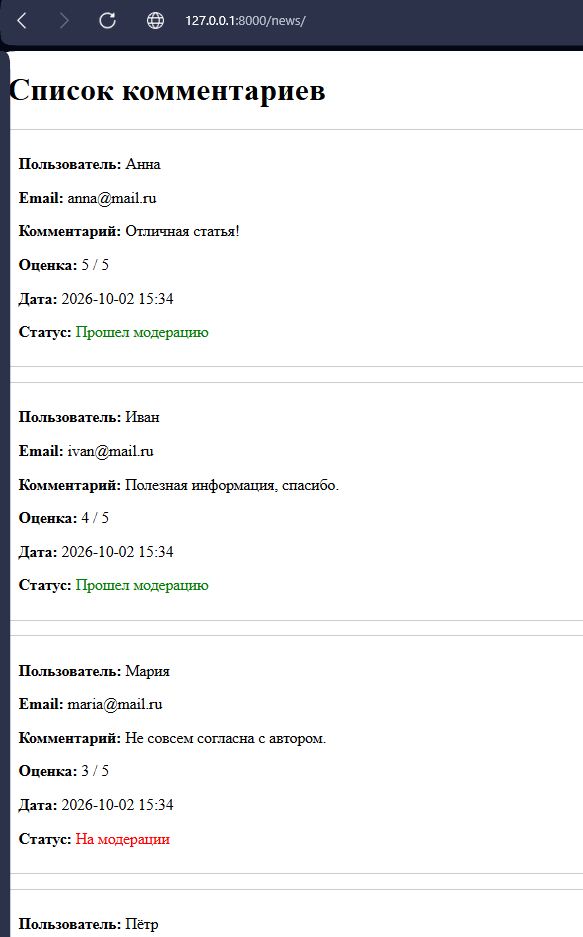
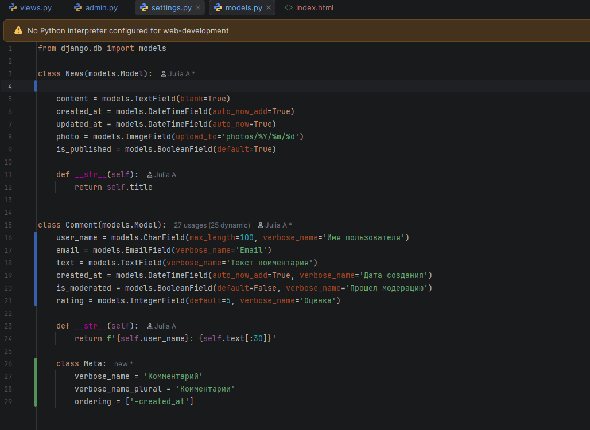
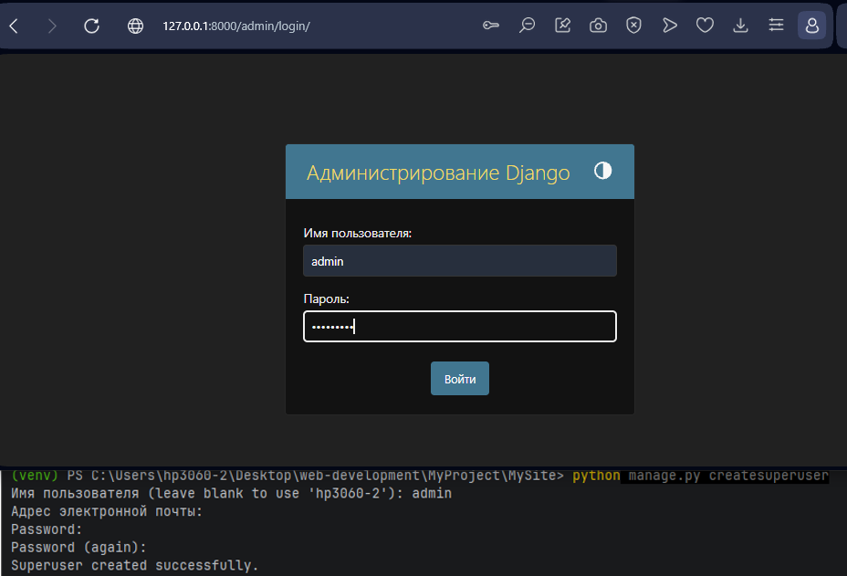
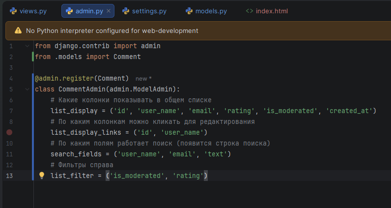
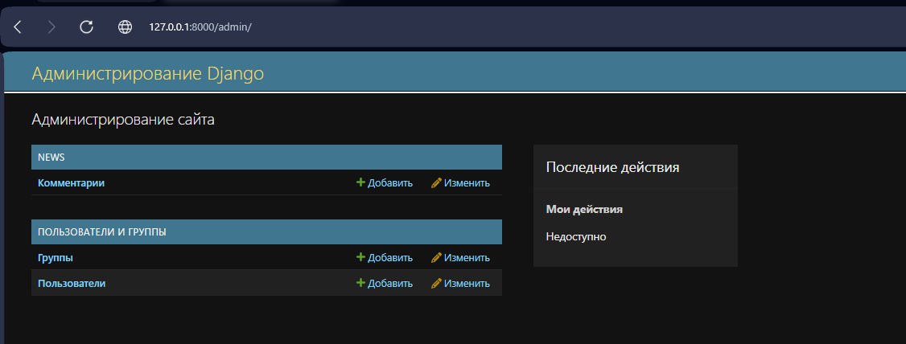

МИНИСТЕРСТВО НАУКИ И ВЫСШЕГО ОБРАЗОВАНИЯ РОССИЙСКОЙ ФЕДЕРАЦИИ
Федеральное государственное автономное образовательное учреждение высшего образования
«СЕВЕРО-КАВКАЗСКИЙ ФЕДЕРАЛЬНЫЙ УНИВЕРСИТЕТ»
Институт информационных технологий и кибербезопасности
Кафедра программной инженерии

# Отчет к лабораторной работе № 3

**Тема:** Шаблоны. Админка Django.
**Дисциплина:** Разработка web-приложений

**Выполнила:**

Студент группы ПИЖ-б-о-25-1 (1),
направление подготовки: 09.03.04 «Программная инженерия»
Алейникова Юлия Андреевна

**Проверила:**

ассистент кафедры перспективной инженерии

Белик Ангелина Игоревна

Ставрополь 2026

---

**Цель работы:** изучить работу с шаблонами Django (рендеринг, контекст, теги, фильтры), настроить административную панель для управления моделью `Comment`.

## Ход выполнения лабораторной работы

**Вариант 3. Комментарии**

Модель: `Comment`

### 1. Вывод данных без шаблона (через HttpResponse)

Для начала был реализован вывод данных напрямую в контроллере `index` без использования HTML-шаблонов. В файле `views.py` была импортирована модель `Comment`, и данные выведены в виде простой строки.

```python
from django.shortcuts import render
from django.http import HttpResponse
from .models import Comment

def index(request):
    # Получаем все комментарии из БД
    comments = Comment.objects.all()
    
    # Формируем HTML-строку
    res = '<h1>Список комментариев</h1>'
    for item in comments:
        res += f'<div><p>Пользователь: {item.user_name}</p><p>Комментарий: {item.text}</p></div><hr>'
        
    return HttpResponse(res)

def test(request):
    return HttpResponse('<h1>Тестовая страница</h1>')
```




*(Рисунок 1 – Вывод списка комментариев через HttpResponse (без шаблона))*

**Недостаток:** текст выводится без стандартных HTML-тегов (`<html>`, `<body>`), код контроллера загромождается, стили подключить невозможно.

### 2. Создание HTML-шаблона

Для разделения логики и представления был создан файл шаблона `news/templates/news/index.html`. В нём использованы основные элементы шаблонизатора Django:

- **Переменные (директивы):** `{{ title }}`, `{{ item.user_name }}`, `{{ item.email }}`.
- **Теги:** `` (цикл), `` (условие), `` (если список пуст).
- **Фильтры:** `{{ item.created_at|date:"Y-m-d H:i" }}` (форматирование даты).

```html
<!DOCTYPE html>
<html lang="ru">
<head>
    <meta charset="UTF-8">
    <title>{{ title }}</title>
</head>
<body>
    <h1>{{ title }}</h1>

    
        <div style="border: 1px solid #ccc; margin-bottom: 15px; padding: 10px;">
            <p><strong>Пользователь:</strong> {{ item.user_name }}</p>
            <p><strong>Email:</strong> {{ item.email }}</p>
            <p><strong>Комментарий:</strong> {{ item.text }}</p>
            <p><strong>Оценка:</strong> {{ item.rating }} / 5</p>
            <p><strong>Дата:</strong> {{ item.created_at|date:"Y-m-d H:i" }}</p>
            
            <p>
                <strong>Статус:</strong> 
                
                    <span style="color: green;">Прошел модерацию</span>
                
                    <span style="color: red;">На модерации</span>
                
            </p>
        </div>
    
        <p>Комментариев пока нет.</p>
    
</body>
</html>
```




*(Рисунок 2 – Код шаблона index.html)*

### 3. Подключение шаблона (функция render)

Контроллер `index` был переписан. Вместо склеивания строк теперь используется функция `render`, которая принимает объект запроса, путь к шаблону и словарь контекста с данными.

```python
from django.shortcuts import render
from django.http import HttpResponse
from .models import Comment

def index(request):
    # Получаем все комментарии
    comments = Comment.objects.all()
    
    # Формируем контекст — данные для передачи в шаблон
    context = {
        'comments': comments,
        'title': 'Список комментариев'
    }
    
    # Рендерим шаблон и передаем туда контекст
    return render(request, 'news/index.html', context)

def test(request):
    return HttpResponse('<h1>Тестовая страница</h1>')
```




*(Рисунок 3 – Контроллер index с передачей контекста в views.py)*

**Результат:** страница в браузере стала отображать данные в аккуратном виде (с рамками, датами и статусами).




*(Рисунок 4 – Страница со списком комментариев после подключения шаблона)*

### 4. Настройка модели (сортировка и русификация)

В файл `models.py` в класс `Comment` были добавлены:

1. `verbose_name` для каждого поля (для отображения на русском языке в админке).
2. Подкласс `Meta` для задания названия модели и сортировки по умолчанию (`ordering = ['-created_at']` – новые комментарии сверху).

```python
from django.db import models

class Comment(models.Model):
    user_name = models.CharField(max_length=100, verbose_name='Имя пользователя')
    email = models.EmailField(verbose_name='Email')
    text = models.TextField(verbose_name='Текст комментария')
    created_at = models.DateTimeField(auto_now_add=True, verbose_name='Дата создания')
    is_moderated = models.BooleanField(default=False, verbose_name='Прошел модерацию')
    rating = models.IntegerField(default=5, verbose_name='Оценка')

    def __str__(self):
        return f'{self.user_name}: {self.text[:30]}'

    class Meta:
        verbose_name = 'Комментарий'
        verbose_name_plural = 'Комментарии'
        ordering = ['-created_at']
```




*(Рисунок 5 – Модель Comment с настройками verbose_name и Meta)*

## Настройка админки Django

### 5.1. Создание суперпользователя

Для доступа в административную панель был создан суперпользователь с логином `admin`.

```bash
python manage.py createsuperuser
```




*(Рисунок 6 – Создание суперпользователя и вход в админку)*

### 5.2. Регистрация модели и настройка отображения

В файле `admin.py` модель `Comment` была зарегистрирована с помощью декоратора `@admin.register` и кастомного класса `CommentAdmin`. Это позволило настроить список отображаемых колонок, поиск и фильтры.

```python
from django.contrib import admin
from .models import Comment

@admin.register(Comment)
class CommentAdmin(admin.ModelAdmin):
    # Какие колонки показывать в общем списке
    list_display = ('id', 'user_name', 'email', 'rating', 'is_moderated', 'created_at')
    # По каким колонкам можно кликать для редактирования
    list_display_links = ('id', 'user_name')
    # По каким полям работает поиск (появится строка поиска)
    search_fields = ('user_name', 'email', 'text')
    # Фильтры справа
    list_filter = ('is_moderated', 'rating')
```




*(Рисунок 7 – Настройка CommentAdmin в admin.py)*

### 5.3. Результат в админке

После обновления страницы в админке появился раздел «NEWS» с пунктом «Комментарии», где доступны все созданные записи. Благодаря настройкам `CommentAdmin` появились строка поиска и панель фильтров.




*(Рисунок 8 – Раздел «Комментарии» в административной панели)*

**Ссылка на гитхаб:** https://github.com/aiilluj/web_development.git

## Вывод

В ходе лабораторной работы были успешно освоены шаблоны Django: реализована передача контекста из контроллера в HTML-файл, изучены основные теги (`for`, `if`) и фильтры (форматирование дат). Также была настроена административная панель: создан суперпользователь, зарегистрирована модель `Comment`, настроены колонки, поиск и фильтры, а также выполнена русификация полей модели.