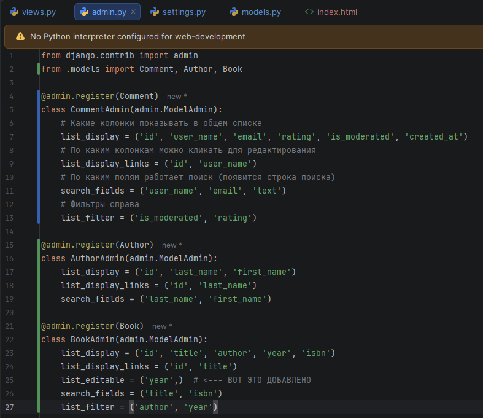
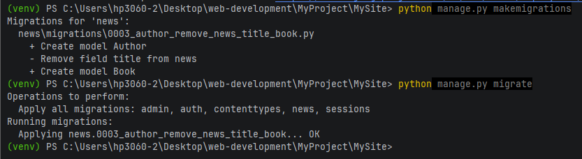
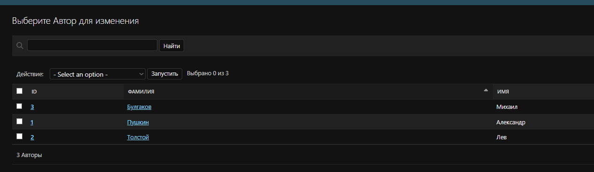
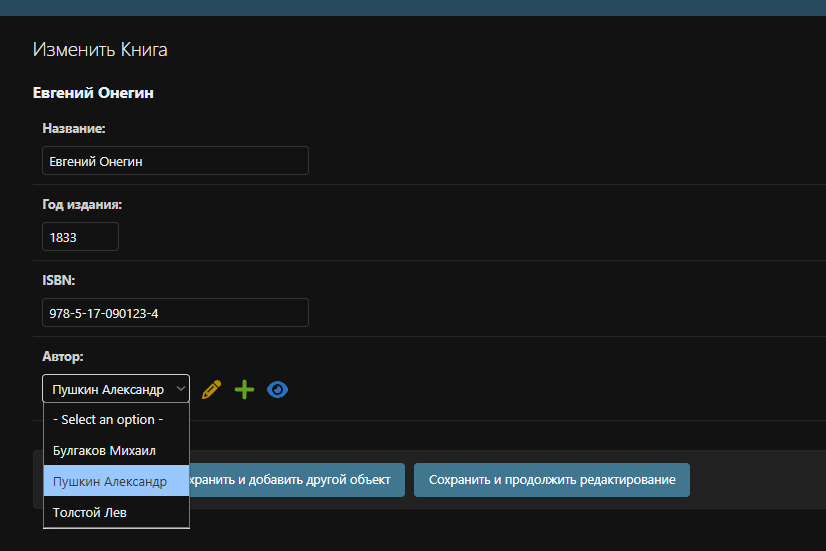
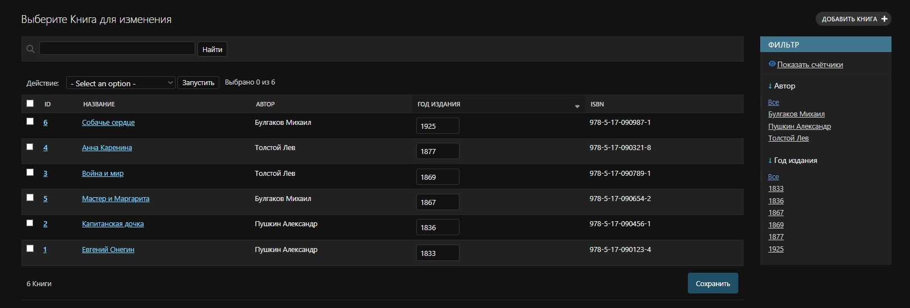
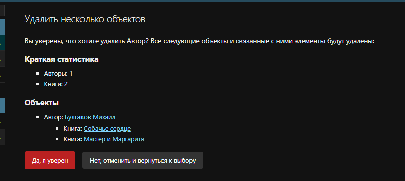
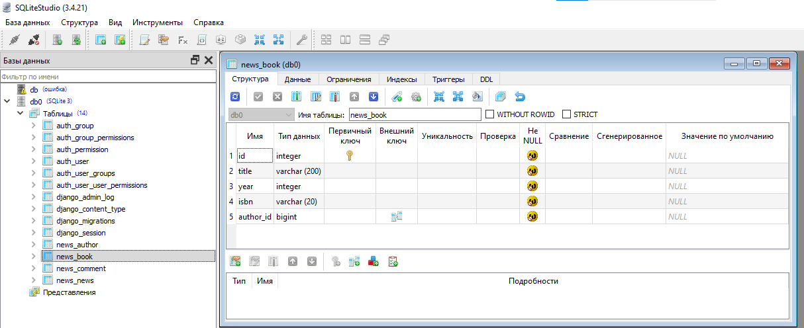
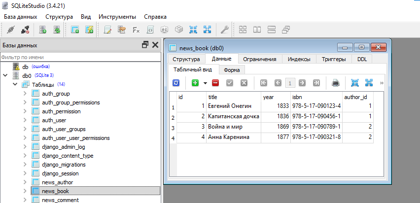

МИНИСТЕРСТВО НАУКИ И ВЫСШЕГО ОБРАЗОВАНИЯ РОССИЙСКОЙ ФЕДЕРАЦИИ
Федеральное государственное автономное образовательное учреждение высшего образования
«СЕВЕРО-КАВКАЗСКИЙ ФЕДЕРАЛЬНЫЙ УНИВЕРСИТЕТ»
Институт информационных технологий и кибербезопасности
Кафедра программной инженерии

# Отчет к лабораторной работе № 4

**Тема:** Связи моделей. Внешний вид шаблона.
**Дисциплина:** Разработка web-приложений

**Выполнила:**

Студент группы ПИЖ-б-о-25-1 (1),
направление подготовки: 09.03.04 «Программная инженерия»
Алейникова Юлия Андреевна

**Проверила:**

ассистент кафедры перспективной инженерии

Белик Ангелина Игоревна

Ставрополь 2026

---

**Цель работы:** Освоить создание и настройку связей между моделями Django (`ForeignKey`, `ManyToManyField`, `OneToOneField`), изучить параметры связей (`on_delete`, `related_name`, `null`, `blank`, `default`), научиться применять миграции при добавлении связей к существующим моделям, а также настраивать отображение связанных данных в административной панели Django.

## Ход выполнения лабораторной работы

## Индивидуальное задание

**Вариант 3.**

1. Создать две или более связанных моделей в Django.
2. Применить соответствующее поле связи (`ForeignKey`, `ManyToManyField` или `OneToOneField`).
3. Настроить параметры связи (`on_delete`, `related_name`, `null`, `blank`, `default`).
4. Выполнить миграции и убедиться в корректности структуры БД.
5. Зарегистрировать модели в `admin.py` и настроить отображение связанных данных (`list_display`, `list_filter`, `list_editable`, `search_fields`).
6. Проверить работу через админ-панель: создать записи, связать их, проверить каскадные операции.

**Вариант 3. Библиотека: книги и авторы**

| Компонент | Описание |
| :--- | :--- |
| Первичная модель | `Author` (имя, фамилия, биография, фото) |
| Вторичная модель | `Book` (название, год издания, ISBN) |
| Тип связи | `ForeignKey` (один автор — много книг) |
| `on_delete` | `CASCADE` (при удалении автора удаляются его книги) |
| Дополнительно | Добавить `related_name='books'` для обратного доступа |

## 1. Теоретическое обоснование

В Django для организации связей между таблицами используются специальные поля. В данной работе применяется `ForeignKey` (отношение «многие к одному»). Один автор может написать много книг, но у каждой книги есть только один автор.

Параметры связи, использованные в работе:

- `on_delete=models.CASCADE` – при удалении автора каскадно удаляются все связанные с ним книги.
- `related_name='books'` – позволяет из объекта автора получить доступ к его книгам (`author.books.all()`).
- `null=True` и `blank=True` – для поля `photo` в модели `Author`, чтобы фото было необязательным.

## 2. Код моделей и настройка админки

В файле `models.py` были созданы две связанные модели. В файле `admin.py` была произведена настройка отображения этих моделей для удобной работы (списки, фильтры, поиск, редактирование на лету).

```python
# models.py
from django.db import models

class Author(models.Model):
    first_name = models.CharField(max_length=100, verbose_name='Имя')
    last_name = models.CharField(max_length=100, verbose_name='Фамилия')
    biography = models.TextField(blank=True, verbose_name='Биография')
    photo = models.ImageField(upload_to='authors/', blank=True, null=True, verbose_name='Фото')

    def __str__(self):
        return f'{self.last_name} {self.first_name}'

    class Meta:
        verbose_name = 'Автор'
        verbose_name_plural = 'Авторы'


class Book(models.Model):
    title = models.CharField(max_length=200, verbose_name='Название')
    year = models.IntegerField(verbose_name='Год издания')
    isbn = models.CharField(max_length=20, unique=True, verbose_name='ISBN')
    author = models.ForeignKey(
        Author, 
        on_delete=models.CASCADE, 
        related_name='books', 
        verbose_name='Автор'
    )

    def __str__(self):
        return self.title

    class Meta:
        verbose_name = 'Книга'
        verbose_name_plural = 'Книги'
```





*(Рисунок 1 – Код файла admin.py с регистрацией моделей Author и Book)*

## 3. Применение миграций

После внесения изменений в модели (добавления новых таблиц и связей) были выполнены команды для создания и применения миграций. Django успешно создал новые таблицы в базе данных.

```bash
python manage.py makemigrations
python manage.py migrate
```




*(Рисунок 2 – Выполнение команд makemigrations и migrate в терминале)*

## 4. Работа в административной панели

### 4.1. Список авторов

В админке был создан раздел «Авторы». Благодаря настройкам `list_display` и `list_display_links` отображаются ID, Фамилия и Имя, а по ним работает поиск.




*(Рисунок 3 – Список авторов в административной панели)*

### 4.2. Форма добавления книги

При создании книги используется поле `ForeignKey`. В выпадающем списке поля «Автор» доступны все ранее созданные авторы.



*(Рисунок 4 – Форма редактирования книги с выбором автора из списка)*

### 4.3. Список книг с фильтрами

В общем списке книг отображаются колонки (ID, Название, Автор, Год, ISBN). Благодаря настройкам справа появилась панель фильтров по автору и году, а поле «Год издания» можно редактировать прямо из списка.




*(Рисунок 5 – Список книг с фильтрами и редактируемым полем)*

### 4.4. Проверка каскадного удаления (CASCADE)

При попытке удалить автора (например, Булгакова) Django выдает предупреждение, в котором указано, что вместе с ним будут удалены все связанные объекты (его книги).




*(Рисунок 6 – Окно подтверждения каскадного удаления автора и его книг)*

## 5. Проверка структуры базы данных (SQLiteStudio)

Была открыта база данных `db.sqlite3` для проверки того, как связь реализована на уровне СУБД.

### 5.1. Структура таблицы

В таблице `news_book` появилось поле `author_id`, которое является внешним ключом (`FOREIGN KEY`), ссылающимся на таблицу авторов.




*(Рисунок 7 – Структура таблицы news_book в SQLiteStudio)*

### 5.2. Данные в таблице

На вкладке «Данные» видно, что в колонке `author_id` записаны числовые идентификаторы авторов (например, у Пушкина `id=1`, у Толстого `id=2`).




*(Рисунок 8 – Данные таблицы news_book с идентификаторами авторов)*

**Ссылка на гитхаб:** https://github.com/aiilluj/web_development.git

## Вывод

В ходе лабораторной работы были изучены связи «многие к одному» (`ForeignKey`). Настроены параметры `on_delete=CASCADE` и `related_name`. Выполнены миграции, созданы таблицы с внешними ключами. Административная панель настроена для удобной работы со связанными данными.