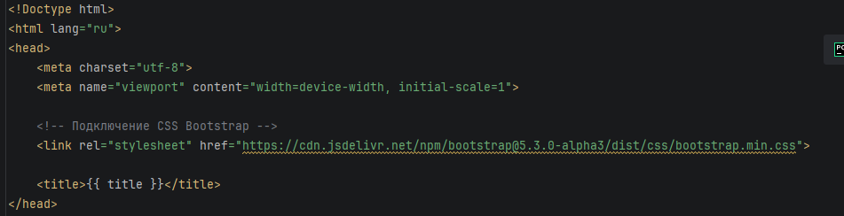
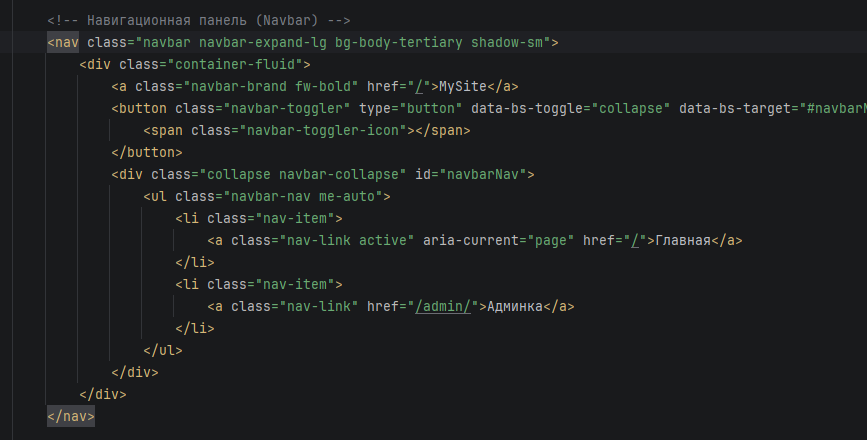
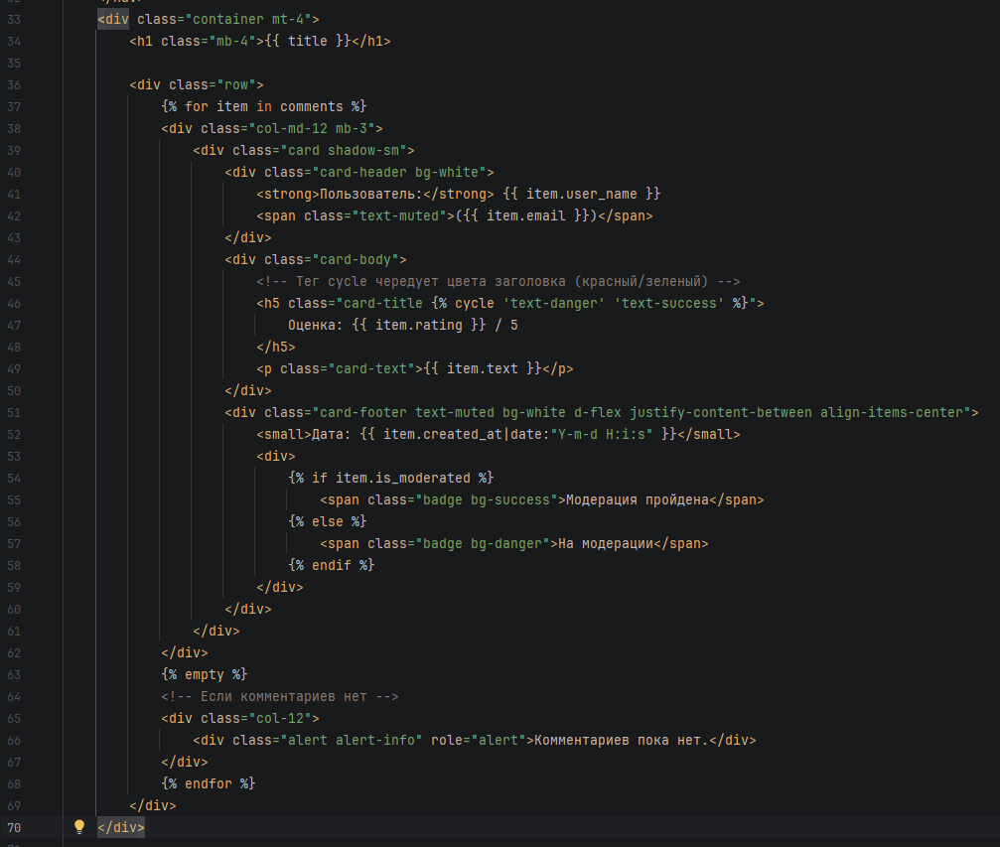
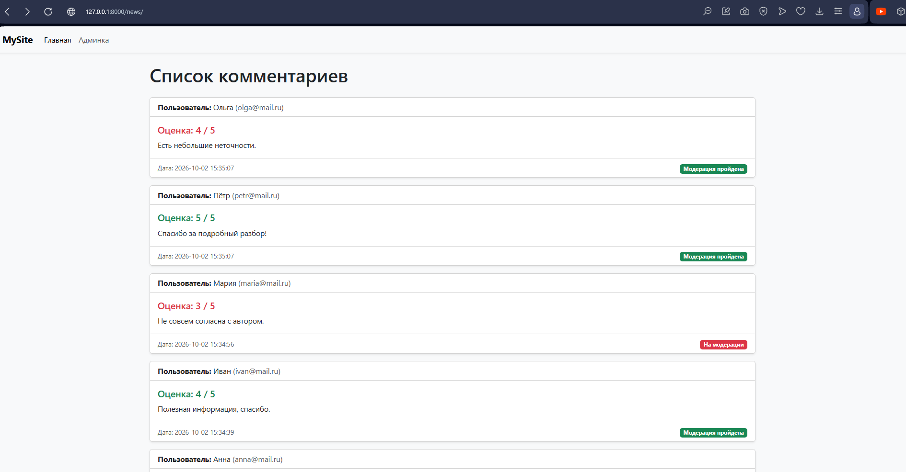
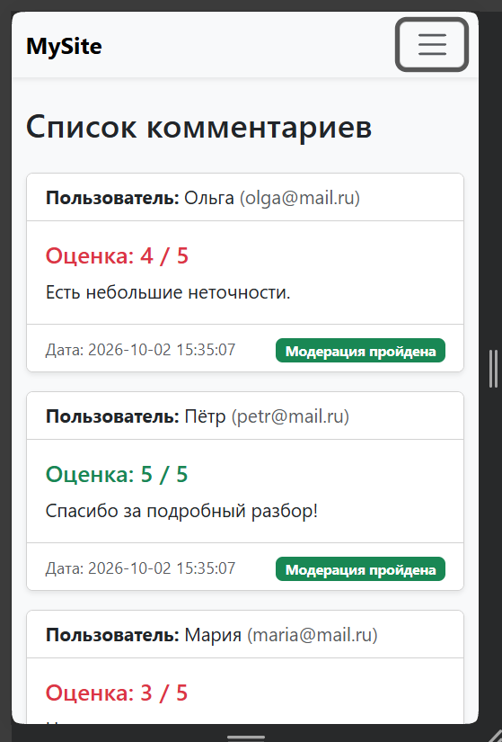

МИНИСТЕРСТВО НАУКИ И ВЫСШЕГО ОБРАЗОВАНИЯ РОССИЙСКОЙ ФЕДЕРАЦИИ
Федеральное государственное автономное образовательное учреждение высшего образования
«СЕВЕРО-КАВКАЗСКИЙ ФЕДЕРАЛЬНЫЙ УНИВЕРСИТЕТ»
Институт информационных технологий и кибербезопасности
Кафедра программной инженерии

# Отчет к лабораторной работе № 5

**Тема:** Внешний вид шаблона. Директивы. Теги. Фильтры.
**Дисциплина:** Разработка web-приложений

**Выполнила:**

Студент группы ПИЖ-б-о-25-1 (1),
направление подготовки: 09.03.04 «Программная инженерия»
Алейникова Юлия Андреевна

**Проверила:**

ассистент кафедры перспективной инженерии

Белик Ангелина Игоревна

Ставрополь 2026

---

**Цель работы:** научиться подключать CSS/JS фреймворк Bootstrap через CDN, применять компоненты (Navbar, Card) и настраивать адаптивный дизайн для вывода данных из базы.

## Ход выполнения лабораторной работы

### 1. Подключение Bootstrap

Фреймворк Bootstrap не требует скачивания файлов. Он подключается через сеть доставки контента (CDN). В файл шаблона `news/templates/news/index.html` в секцию `<head>` была добавлена ссылка на CSS-файл Bootstrap 5.3, а перед закрывающим тегом `</body>` – скрипт JavaScript.

```html
<!DOCTYPE html>
<html lang="ru">
<head>
    <meta charset="utf-8">
    <meta name="viewport" content="width=device-width, initial-scale=1">

    <!-- Подключение CSS Bootstrap -->
    <link rel="stylesheet" href="https://cdn.jsdelivr.net/npm/bootstrap@5.3.0-alpha3/dist/css/bootstrap.min.css">
    
    <title>{{ title }}</title>
</head>
<body>
    <!-- ... контент ... -->

    <!-- Подключение JS Bootstrap -->
    <script src="https://cdn.jsdelivr.net/npm/bootstrap@5.3.0-alpha3/dist/js/bootstrap.bundle.min.js"></script>
</body>
</html>
```




*(Рисунок 1 – Подключение CSS и JS Bootstrap в файле index.html.)*

### 2. Создание навигационной панели (Navbar)

Для удобной навигации по сайту был использован готовый компонент Navbar из документации Bootstrap. Он был вставлен сразу после открывающего тега `<body>`. В панель добавлены ссылки «Главная» (ведет на `/`) и «Админка» (ведет на `/admin/`).

```html
<!-- Навигационная панель (Navbar) -->
<nav class="navbar navbar-expand-lg bg-body-tertiary shadow-sm">
  <div class="container-fluid">
    <a class="navbar-brand fw-bold" href="/">MySite</a>
    <button class="navbar-toggler" type="button" data-bs-toggle="collapse" data-bs-target="#navbarNav">
      <span class="navbar-toggler-icon"></span>
    </button>
    <div class="collapse navbar-collapse" id="navbarNav">
      <ul class="navbar-nav me-auto">
        <li class="nav-item">
          <a class="nav-link active" aria-current="page" href="/">Главная</a>
        </li>
        <li class="nav-item">
          <a class="nav-link" href="/admin/">Админка</a>
        </li>
      </ul>
    </div>
  </div>
</nav>
```




*(Рисунок 2 – Код панели навигации (Navbar) в шаблоне)*

### 3. Верстка списка комментариев с помощью карточек (Cards)

Раньше каждый комментарий выводился простым текстом, разделенным линиями. Теперь для каждого элемента используется компонент Card.

**Структура карточки:**

- **Header:** Имя пользователя и Email.
- **Body:** Оценка (с чередованием цвета) и текст комментария.
- **Footer:** Дата создания и статус модерации (в виде цветного бейджа).

Для чередования цвета текста (красный/зеленый) был использован встроенный тег шаблонизатора Django – ``.

```html
<div class="container mt-4">
    <h1 class="mb-4">{{ title }}</h1>

    <div class="row">
        
            <div class="col-md-12 mb-3">
                <div class="card shadow-sm">
                    <div class="card-header bg-white">
                        <strong>Пользователь:</strong> {{ item.user_name }}
                        <span class="text-muted">({{ item.email }})</span>
                    </div>
                    <div class="card-body">
                        <!-- Тег cycle чередует цвета заголовка (красный/зеленый) -->
                        <h5 class="card-title ">
                            Оценка: {{ item.rating }} / 5
                        </h5>
                        <p class="card-text">{{ item.text }}</p>
                    </div>
                    <div class="card-footer text-muted bg-white d-flex justify-content-between align-items-center">
                        <small>Дата: {{ item.created_at|date:"Y-m-d H:i:s" }}</small>
                        <div>
                            
                                <span class="badge bg-success">Модерация пройдена</span>
                            
                                <span class="badge bg-danger">На модерации</span>
                            
                        </div>
                    </div>
                </div>
            </div>
        
            <!-- Если комментариев нет -->
            <div class="col-12">
                <div class="alert alert-info" role="alert">Комментариев пока нет.</div>
            </div>
        
    </div>
</div>
```




*(Рисунок 3 – Код вывода комментариев в виде карточек с тегом cycle)*

### 4. Проверка результата в браузере

После сохранения шаблона и обновления страницы http://127.0.0.1:8000/news/ дизайн сайта полностью изменился.

**Что видно на странице:**

1. Сверху закреплена серая панель навигации с ссылками.
2. Комментарии выводятся в аккуратных белых карточках с легкой тенью.
3. Заголовки оценок поочередно окрашиваются в красный и зеленый цвета.
4. Статус модерации выделен ярлыками: зеленым (прошел) и красным (не прошел).




*(Рисунок 4 – Итоговый вид страницы с комментариями после внедрения Bootstrap)*

### 5. Проверка адаптивности

Одним из главных преимуществ Bootstrap является адаптивность. Если сузить окно браузера (или открыть сайт с телефона), карточки автоматически подстроятся под ширину экрана, а панель навигации свернется в кнопку-гамбургер.




*(Рисунок 5 – Отображение сайта на узком экране (адаптивная верстка))*

**Ссылка на гитхаб:** https://github.com/aiilluj/web_development.git

## Вывод

В ходе лабораторной работы был освоен CSS-фреймворк Bootstrap. Изучено подключение библиотек через CDN и использование готовых компонентов (Navbar, Card, Container, Grid) для быстрого создания современного и адаптивного дизайна. Также на практике был применен тег `` для динамического изменения стилей. Сайт приобрел профессиональный внешний вид, при этом код HTML-шаблона остался чистым и структурированным.